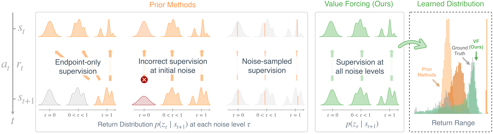

<div align="center">

<div id="user-content-toc" style="margin-bottom: 50px">
  <ul align="center" type="none">
    <summary>
      <h1 style="font-size:1.76rem">
        Value Forcing: Aligning Return Distributions<br>
        at All Noise Levels
      </h1>
      <br>
      <h2>
        <a href="https://chongyi-zheng.github.io/value-forcing/" style="font-size:20px;">Website</a>
      </h2>
    </summary>
  </ul>
</div>

</div>



## Overview

**Value Forcing** is a distributional reinforcement learning framework that learns return distributions with flow matching. Its flow Bellman equation enforces Bellman consistency at *every* noise level, resulting in more accurate return distributions. Value Forcing improves policy performance especially when a small amount of data is available.

This repository implements two offline RL algorithms based on this framework:

- **VF** evaluates the return distribution of an explicit policy and then performs policy improvement.
- **IVF** learns return distributions through an expectile-weighted objective and selects actions from a learned behavior policy.

We also include implementations for 11 baselines and instructions for running experiments on 20 tasks from [OGBench](https://github.com/seohongpark/ogbench) and 6 tasks from [OCBench](https://github.com/seohongpark/ocbench).

## Installation

Both OGBench and OCBench use one Python 3.10 environment on Linux with an NVIDIA GPU (CUDA 12).
The shared dependencies, including OCBench and MJWarp, are defined in `pyproject.toml` and locked in `uv.lock`.
The Conda and pip setup uses the same direct dependencies from `requirements.txt`.
From the repository root, choose one of the following methods to create `.venv`.

**With uv**

```bash
uv sync --locked --python 3.10
source .venv/bin/activate
```

**With conda and pip**

```bash
conda create --prefix ./.venv python=3.10 pip -y
conda activate ./.venv
python -m pip install -r requirements.txt
```

The examples below use `source .venv/bin/activate`. With Conda, use `conda activate ./.venv` instead.
The same environment runs both benchmark suites.

## Environments and datasets

We experiment with simulated environments from [OGBench](https://github.com/seohongpark/ogbench) and [OCBench](https://github.com/seohongpark/ocbench).

### OGBench

We use `cube-triple`, `cube-quadruple`, `puzzle-4x4`, and `humanoidmaze-giant` domains, with tasks 1–5 for each.
The datasets for these four domains contain 100M training transitions each and can be found below:

- [cube-triple-play-100m-v0](https://rail.eecs.berkeley.edu/datasets/ogbench/cube-triple-play-100m-v0/),
  [cube-quadruple-play-100m-v0](https://rail.eecs.berkeley.edu/datasets/ogbench/cube-quadruple-play-100m-v0/),
  [puzzle-4x4-play-100m-v0](https://rail.eecs.berkeley.edu/datasets/ogbench/puzzle-4x4-play-100m-v0/), and
  [humanoidmaze-giant-navigate-100m-v0](https://rail.eecs.berkeley.edu/datasets/ogbench/humanoidmaze-giant-navigate-100m-v0/).
- Alternative Hugging Face link: [https://huggingface.co/datasets/zhouzypaul/ogbench_datasets/tree/main](https://huggingface.co/datasets/zhouzypaul/ogbench_datasets/tree/main).

### OCBench

We use six lite datasets from OCBench: `block-lite-single-task1-v0`, `block-lite-double-{task1,task2}-v0`, and
`chamber-lite-easy-{task1,task2,task3}-v0`. Download all training and validation shards for these tasks from
[Hugging Face](https://huggingface.co/datasets/seohongpark/ocbench/tree/main/lite).
Each training shard contains 10K trajectories, with 1K trajectories in its matching validation shard.

## Running a single experiment

We run experiments through `main.py` from the repository root. Select the method with `--agent=agents/<agent>.py` and override its configurations with `--agent.<key>=<value>`. Replace `/path/to/ogbench` and `/path/to/ocbench` with your dataset locations.

Before training, the code scans the datasets to find the minimum and maximum rewards. To save time on later runs
with the same task and datasets, create a cache directory and add `--reward_bounds_cache_dir=/path/to/cache`
to your training command.

### VF on OGBench

Run VF on `cube-triple-play-singletask-task1-v0` with a 25% subset of the 100M-transition dataset:

```bash
source .venv/bin/activate
MUJOCO_GL=egl python main.py \
    --agent=agents/value_forcing.py \
    --env_name=cube-triple-play-singletask-task1-v0 \
    --dataset_dir=/path/to/ogbench/cube-triple-play-100m-v0 \
    --dataset_subset_fraction=0.25 \
    --dataset_replace_interval=1000 \
    --eval_episodes=10 \
    --save_dir=exp/reproduction/vf-ogbench \
    --wandb_run_group=ogbench_vf
```

### IVF on OCBench

Run IVF on `chamber-lite-easy-task1-v0` with a 25% subset. The memory settings let JAX share the GPU with MJWarp during
evaluation.

```bash
source .venv/bin/activate
MUJOCO_GL=egl XLA_PYTHON_CLIENT_PREALLOCATE=false XLA_CLIENT_MEM_FRACTION=0.8 python main.py \
    --agent=agents/implicit_value_forcing.py \
    --env_name=chamber-lite-easy-task1-v0 \
    --dataset_dir=/path/to/ocbench/lite/chamber-lite-easy-task1-v0 \
    --dataset_subset_fraction=0.25 \
    --dataset_replace_interval=10000 \
    --agent.discount=0.9999 \
    --agent.mlp_class=resmlp \
    --agent.actor_hidden_dims='(1024, 1024, 1024, 1024, 1024, 1024, 1024, 1024)' \
    --agent.value_hidden_dims='(1024, 1024, 1024, 1024, 1024, 1024, 1024, 1024)' \
    --eval_episodes=500 \
    --save_dir=exp/reproduction/ivf-ocbench \
    --wandb_run_group=ocbench_ivf
```

### Saving and resuming

By default, training saves a checkpoint every 50,000 updates and at the end. Choose how many to keep with
`--save_keep_last`:

- `N > 0` (default: `1`): keep the latest N during training, then only the final checkpoint.
- `0`: save no checkpoints.
- `-1`: keep all checkpoints.

To resume from the checkpoint `params_M.pkl`, add these flags to the original training command:

```bash
--restore_path=/path/to/run \
--restore_epoch=M \
--start_step=M
```

Replace `/path/to/run` with the checkpoint folder and `M` with the saved step. Training continues at step `M + 1`.
Keep the other settings, including the total `--offline_steps`, unchanged. Logs and checkpoints stay in the same
folder.

## Reproducing experiment results

We use [reproduce.py](reproduce.py) to generate Slurm scripts with the experiment settings for each benchmark.

### VF and IVF

On OGBench:

```bash
python reproduce.py ogbench --data_root=/path/to/ogbench --methods vf ivf --slurm
bash sbatch/vf_ogbench.sh
bash sbatch/ivf_ogbench.sh
```

On OCBench:

```bash
python reproduce.py ocbench --data_root=/path/to/ocbench --methods vf ivf --slurm
bash sbatch/vf_ocbench.sh
bash sbatch/ivf_ocbench.sh
```

Each script submits one job array, with one experiment per task. OGBench runs all 20 tasks at 10%, 25%, 50%, and
100% data budgets; OCBench runs all six tasks at 25% and 100%. Both use seeds 100, 200, 300, and 400, giving 320
experiments per method on OGBench and 48 on OCBench.

### Baselines

Generate scripts for each group, then submit each Slurm array:

On OGBench:

```bash
# Explicit baselines
python reproduce.py ogbench --data_root=/path/to/ogbench \
    --methods floq flow_critic value_flows pcbf c51 iqn qc \
    --slurm

bash sbatch/floq_ogbench.sh
bash sbatch/flow_critic_ogbench.sh
bash sbatch/value_flows_ogbench.sh
bash sbatch/pcbf_ogbench.sh
bash sbatch/c51_ogbench.sh
bash sbatch/iqn_ogbench.sh
bash sbatch/qc_ogbench.sh

# Implicit baselines
python reproduce.py ogbench --data_root=/path/to/ogbench \
    --methods divl implicit_c51 implicit_iqn implicit_qc \
    --slurm

bash sbatch/divl_ogbench.sh
bash sbatch/implicit_c51_ogbench.sh
bash sbatch/implicit_iqn_ogbench.sh
bash sbatch/implicit_qc_ogbench.sh
```

On OCBench:

```bash
# Explicit baselines
python reproduce.py ocbench --data_root=/path/to/ocbench \
    --methods value_flows c51 qc \
    --slurm

bash sbatch/value_flows_ocbench.sh
bash sbatch/c51_ocbench.sh
bash sbatch/qc_ocbench.sh

# Implicit baselines
python reproduce.py ocbench --data_root=/path/to/ocbench \
    --methods implicit_c51 implicit_qc \
    --slurm

bash sbatch/implicit_c51_ocbench.sh
bash sbatch/implicit_qc_ocbench.sh
```

## Acknowledgments

This codebase builds on [Q-Guided Flow](https://github.com/zhouzypaul/qgf) and [Value Flows](https://github.com/chongyi-zheng/value-flows).

## License

This project is licensed under the [MIT License](LICENSE).

## BibTeX

```bibtex
@misc{zheng2026value,
  title={Value Forcing: Aligning Return Distributions at All Noise Levels},
  author={Zheng, Chongyi and Zhou, Zhiyuan and Li, Qiyang and Eysenbach, Benjamin and Levine, Sergey},
  year={2026},
}
```
